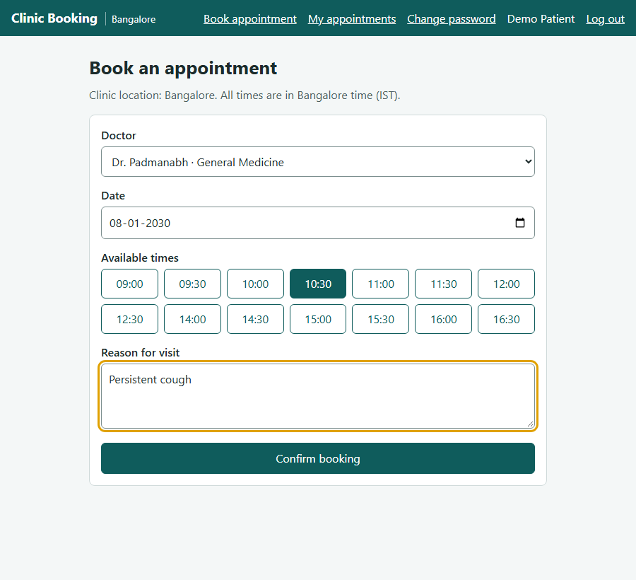

# Clinic Booking: Test Automation Portfolio

[](https://github.com/Padmanabh91/clinic-booking/actions/workflows/tests.yml)

A test automation project built around a working appointment booking app for a clinic in Bangalore. The suite uses **Playwright and plain JavaScript** across five layers: database, API, a server layer with a movable clock, cross-browser UI, and end-to-end journeys. It also covers accessibility, a phone layout, a race for the same slot and a session ending mid-booking. **Bug mode** proves the tests can actually fail: it switches on ten known bugs one at a time and checks that each one turns tests red. The whole suite runs in parallel in about 6 minutes, and CI runs it on every push.



## The test pyramid
| Layer | Folder | Tests | Test runs | What it proves |
|---|---|---|---|---|
| Journeys | `tests/ui/journeys/` | 4 | 12 (3 browsers) | A patient's and an admin's whole journey, a race for one slot, a session ending mid-booking |
| UI and accessibility | `tests/ui/` | 120 | 360 (3 browsers) | What users see: messages, loading/empty/error states, focus, keyboard use, axe checks, the 375px layout |
| Server | `tests/server/` | 53 | 53 | Rules that need time to pass (sessions, the sign-in limit, outcomes), settings, clean shutdown |
| API | `tests/api/` | 147 | 147 | Booking rules, boundaries, permissions and error codes |
| Database | `tests/db/` | 23 | 23 | Migrations, constraints and transactions |
| **Total** | | **347** | **595** | |

Every test is tagged either `@smoke` (27 runs: the journeys and the core booking, cancellation and sign-in tests) or `@regression`.

How the suite stays reliable:
- **Fixed clock:** the shared test server always thinks it's Monday 7 Jan 2030, 10:00 IST, so date rules give the same result on any day.
- **Movable clock on app copies:** tests that need time to pass, or that affect everyone (such as clinic holidays), each start their own copy of the app with its own database and clock.
- **Independent data:** every other test creates its own patient and doctor through the API, so tests run in parallel in any order.
- **Free port per run:** the test server gets a free port, so two runs at once can't collide.
- **Page objects** in `tests/pages/`, and **boundary testing** throughout (for example, cancelling exactly 2 hours before is allowed, and 1.5 hours before is refused).

The [test strategy](docs/test-strategy.md) explains the layers, clocks, isolation and conventions. The [test plan](docs/test-plan.md) maps every business rule to its tests.

## Bug mode
A passing suite doesn't show that it can catch anything. The app has ten known bugs that can be switched on one at a time. `npm run test:bugs`:
1. runs the API and server suites with no bugs on, and checks they all pass;
2. runs them again once per bug, and checks that each bug turns tests red.

| Bug switched on | What it breaks |
|---|---|
| `double-booking` | Two patients can take the same slot |
| `past-booking` | Appointments can be booked in the past |
| `cancel-any` | A patient can cancel someone else's appointment |
| `late-cancel` | The 2-hour cancellation rule is ignored |
| `role-escalation` | Anyone can register as an admin |
| `no-session-expiry` | Sessions never end, however long they go unused |
| `no-login-limit` | Passwords can be guessed without limit |
| `closed-day-booking` | Appointments can be booked on holidays and doctors' leave days |
| `reschedule-keeps-old` | Moving an appointment leaves the old slot booked too |
| `early-outcome` | Appointments can be marked completed or no-show before they start |

## Run the app
**Requires Node.js 22.13 or newer.** The app uses Node's built-in SQLite (`node:sqlite`), which works without a flag from Node 22.13. Node prints `ExperimentalWarning: SQLite is an experimental feature` when the app starts. That warning is expected and harmless.

With npm:
```bash
npm install
npm start          # http://127.0.0.1:3000, data saved in data/clinic.db
```

With Docker (the image uses Node 22 LTS, runs in production mode and keeps the database in a volume at `/data`):
```bash
docker compose up --build      # http://localhost:3000
docker compose down            # stop; the data stays in the volume
```

Settings:
| Variable | Default | Meaning |
|---|---|---|
| `PORT` | `3000` | Port to listen on |
| `HOST` | `127.0.0.1` (`0.0.0.0` in Docker) | Address to listen on |
| `DB_PATH` | `data/clinic.db` (`/data/clinic.db` in Docker) | SQLite file |
| `COOKIE_SECURE` | `true` when `NODE_ENV=production`, otherwise `false` | Send the sign-in cookie over HTTPS only. Must be `true` when the site is served over HTTPS. `docker-compose.yml` sets it to `false` so the app works on plain http://localhost |
| `TRUST_PROXY` | off | Set when a reverse proxy or load balancer sits in front of the app, so the sign-in limit sees each visitor's address instead of the proxy's. Takes Express "trust proxy" values: `true`, a number of proxies such as `1`, or addresses such as `loopback` |

The app closes its database cleanly when it receives SIGTERM (as `docker stop` sends) or Ctrl+C.

### Demo accounts
These accounts are fake and only for trying the app.

| Role | Email | Password |
|---|---|---|
| Patient | `patient@clinic.test` | `Patient@123` |
| Admin | `admin@clinic.test` | `Admin@12345` |

## Run the tests
```bash
npx playwright install                     # once, to download the browsers
npm test                                   # everything, in all three browsers
npm run test:smoke                         # @smoke only: journeys and core tests
npx playwright test --grep @regression     # everything except @smoke
npx playwright test --project=chromium     # UI tests in one browser (or firefox, webkit)
npm run test:api                           # one layer (also test:db, test:server)
npm run test:bugs                          # bug mode
npm run report                             # open the last HTML report
```
The tests start their own server, so `npm start` isn't needed first.

**CI** (`.github/workflows/tests.yml`) runs on every push and pull request:
- **Four parallel test jobs:** API, database and server tests followed by bug mode, and one job each for Chromium, Firefox and WebKit.
- **A fifth job** builds the Docker image and checks that it starts, keeps its data in the volume and shuts down cleanly.
- **Artifacts:** each test job uploads its HTML report, plus traces, screenshots and videos when tests fail.
- **Node version:** pinned in `.nvmrc`.

## The app
Patients register, choose a doctor, date and free slot, then book, reschedule or cancel, and see their upcoming appointments and history. Admins see every appointment and can cancel any of them. They filter by doctor, dates and status, with a count per status. They add, edit and deactivate doctors, set doctors' leave days and clinic holidays, and mark appointments completed or no-show. If a schedule change would affect booked appointments, the admin sees them first. They're only cancelled once the admin confirms, and the patient sees the reason.

The three demo doctors are all named Dr. Padmanabh, so the app shows the specialty with the name wherever a doctor is listed or chosen, for example "Dr. Padmanabh · General Medicine".

**Rules**
- Slots run every 30 minutes from 09:00 to 16:30 IST, with lunch from 13:00 to 14:00, on the doctor's working days.
- A slot can't be double-booked, and a patient can't have two appointments at the same time.
- Bookings open up to 30 days ahead, and past times can't be booked.
- Patients can cancel or reschedule up to 2 hours before the start. Rescheduling keeps the original as a cancelled record linked to the new one.
- After the start time, admins mark each appointment completed or no-show.
- Every cancellation records who cancelled, when and why.
- Sessions end after 8 hours unused or 7 days after sign-in. Sign-in pauses for 15 minutes after 5 failed attempts for an email.

**Tech:** Node.js, Express, SQLite (`node:sqlite`) and plain JavaScript (CommonJS), with no front-end framework. Express is the only runtime dependency.

## Known issues
- **Firefox and axe:** in Firefox, a Playwright role lookup right before an axe scan can crash the page.
  - After a `getByRole('region')` lookup it happens every time, so tests find sections by their heading instead.
  - Separately, the axe check of the admin history page crashes Firefox in 3 of the last 4 full runs and about 1 in 10 runs alone, whatever comes before it. The cause is unknown, so that one check is skipped in Firefox and still runs in Chromium and WebKit.

  Details are in the [test strategy](docs/test-strategy.md#known-issues).
- **WebKit and the skip link:** like Safari with its default settings, WebKit doesn't move focus to links with Tab. The skip link works when focused, but in WebKit the test focuses it directly instead of pressing Tab.

## Project structure
```
src/                server, API routes, booking and security rules, database, settings
public/             the web pages
tests/api/          API tests
tests/db/           database migration and constraint tests
tests/server/       tests that run their own copy of the app
tests/ui/           UI and accessibility tests
tests/ui/journeys/  end-to-end journeys
tests/pages/        page objects
tests/support/      fixtures, API client, app copies, fixed dates
scripts/            bug mode runner
docs/               test plan, test strategy and screenshot
```

## How this was built
I built this project in phases with Claude Code, an AI coding assistant, under my direction and review. I set the scope of each phase, reviewed the code and test results, and approved each phase before the next began. The phases were:
1. bug fixes;
2. database migrations;
3. security and sessions;
4. doctor management;
5. patient and admin features;
6. polish and the test framework;
7. shipping.
